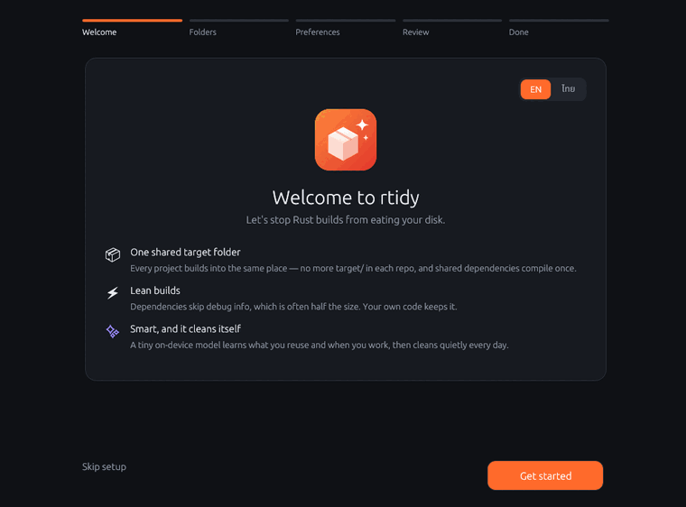
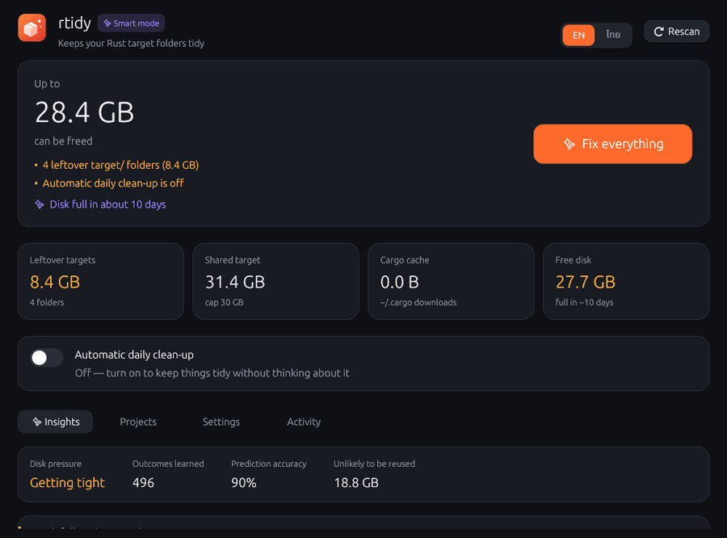

<p align="center"></p>
<h1 align="center">rtidy</h1>
<p align="center">Keeps your Rust <code>target/</code> folders tidy — on Windows, macOS and Linux.<br>
<b>English</b> · <a href="README.th.md">ภาษาไทย</a></p>

<p align="center"></p>

## The problem

Every Rust project grows its own `target/` folder, often several GB each, scattered across your disk.
Shared dependencies get compiled again and again, and nothing ever cleans up.

## What rtidy does (one click)

1. **One shared target folder** — every project builds into the same place (`build.target-dir` in `~/.cargo/config.toml`), so new `target/` folders stop appearing and shared dependencies compile once.
2. **Lean builds** — dependencies skip debug info (often half the size); your own code keeps it.
3. **Removes leftovers** — old per-project `target/` folders (except projects marked *Keep*).
4. **Trims the shared folder** — drops incremental caches and artifacts you won't reuse, and keeps it under a size cap.
5. **Trims the cargo download cache** in `~/.cargo`.
6. **Shows you first, and can put it back** — every clean-up is a plan you can read before it runs, and project folders stay recoverable for a few days.
7. **Cleans itself every day** — Task Scheduler (Windows), launchd (macOS), systemd timer or cron (Linux). Missed runs catch up once, at the next start-up or login.

## Showcase

<table>
<tr>
<td width="50%"><br><b>1. Welcome</b> — first launch opens a setup wizard (EN | ไทย).</td>
<td width="50%"><br><b>2. Folders</b> — common code folders are detected; add or type your own.</td>
</tr>
<tr>
<td><br><b>3. Preferences</b> — Smart mode, lean builds and daily clean-up, with sensible defaults.</td>
<td><br><b>4. Review</b> — see what was found and exactly what will happen, then <i>Tidy up now</i>.</td>
</tr>
<tr>
<td><br><b>Dashboard</b> — what can be freed, the disk forecast and one <i>Fix everything</i> button.</td>
<td><br><b>Projects</b> — every leftover <code>target/</code> with size, age and the AI's chance you'll build it again.</td>
</tr>
<tr>
<td><br><b>Insights (ไทย)</b> — forecast, what you won't reuse, unusual growth and model accuracy.</td>
<td><br><b>Settings</b> — language, Smart mode, folders and hard limits that always apply.</td>
</tr>
</table>

<sub>Screenshots use a demo setup; your numbers will differ.</sub>

## Use cases

| Situation | What rtidy does for you |
|---|---|
| **Laptop with a small SSD** (256–512 GB) that keeps filling up | Forecasts *"disk full in ~N days"*, cleans harder as space runs out, and keeps the shared folder under a cap you choose. |
| **Lots of small projects** — tutorials, Advent of Code, experiments, cloned examples | Stops creating a new `target/` in each one; common crates like `serde`, `tokio` or `syn` compile once and are shared by all. |
| **Open-source contributor** juggling many repos and branches | Projects you've moved on from are removed first (the model learns which ones you return to); mark active ones *Keep* to protect them. |
| **Game / graphics dev** (Bevy, wgpu, egui) with multi-GB debug builds | Lean builds drop dependency debug info, and anomaly alerts flag a sudden jump such as a new release build or toolchain. |
| **Workstation where builds must never slow down** | Smart schedule learns when you never build and runs the clean-up then; anything used in the last day or two is never touched. |
| **Classroom, bootcamp or team machines** | Installer plus a 4-step wizard: anyone can set it up in a minute, in English or Thai, with no terminal needed. |
| **Terminal-only / servers / CI runners** | `rtidy fix` sets everything up in one command; `rtidy auto` runs on a schedule; `rtidy insights` prints the analysis; `rtidy budget 50G` frees just enough before a build, and `rtidy plan --json` hands the whole decision to a script. |

## Smart mode (on-device AI)

A tiny machine-learning brain — no LLM, no GPU, no internet. It is a few hundred numbers in a JSON file, and each analysis takes milliseconds.

- **Reuse prediction.** An online logistic-regression model scores every build unit in the shared folder, and every leftover project `target/`, by the chance you'll use it again within 14 days. Inputs are how recently and how often it was used, how long it has existed, its size and recent git activity. Units you won't need go first; anything used in the last day or two is never touched.
- **It learns from outcomes.** Every prediction is checked 14 days later. If rtidy removed something and you rebuilt it, the model learns it was wrong.
- **Disk forecast.** Weighted regression over free-space history gives "disk full in ~N days". The cleaning threshold and the size cap tighten automatically as the disk fills up.
- **Anomaly alerts.** A robust median/MAD test flags unusual growth, for example a new toolchain or a huge dependency.
- **Smart schedule.** rtidy learns the hours you never build and moves the daily clean-up there.

The **Insights** tab explains every decision. Hard limits from Settings still apply, and Smart mode can be switched off.

## Preview and undo

Nothing is removed on the spot any more. A clean-up first works out a plan — every folder
it would remove, with its size, how many days since it was last built, the model's chance
you'll use it again, an estimate of the time to produce it again and a one-line reason —
and only then carries it out.

The **Preview** tab, and the *Preview…* button on the dashboard, show that plan: the
total, the estimated rebuild time, a breakdown per language and per kind (project folders,
build units, incremental caches, cache entries, store entries), what was left alone and
why, and a *Tidy up now* button. `rtidy plan` prints the same thing in the terminal and
removes nothing.

Project build folders are not unlinked. They are renamed into a `.rtidy-trash` folder at
the top of the same drive — the same filesystem, so the move is instant whatever the size
— and written into an index. `rtidy undo`, or *Undo last clean-up* in the app, puts the
last run back. Entries older than `trash_days` (3 by default, 0–30 in Settings; 0 deletes
outright) are removed for good at the start of the next clean-up, which is when the space
is actually handed back. Caches, build units and store entries are never quarantined: they
re-download or rebuild themselves, so keeping a copy would hold space back for nothing. If
the disk is already critically full, the scheduled run deletes outright instead and says
so in the log.

The plan is ordered by bytes freed per second of rebuilding, discounted by the reuse
chance, rather than by size alone: an 8 GB folder that takes twenty minutes to link ranks
below a 1 GB one that takes five seconds. Every row in **Projects** and in the preview
shows its rebuild time. These are estimates from a per-language throughput figure, not
measurements of your machine.

The **Activity** tab keeps the running total: everything freed since the first run, how
many days that is, the average per day, the number of runs, and the split per language.
Anything you put back is subtracted again, so the figure stays honest.

## Other languages (extra)

rtidy is a Rust tool. Cargo is always on, and it is the only ecosystem with the prevention
trick behind it — one shared target folder. One switch in Settings, **Other languages
(extra)**, is off by default and adds 16 more ecosystems to the same scan, the same
preview, the same undo and the same daily run:

| Language | Build folders it removes | Found by |
|---|---|---|
| Rust (Cargo) — always on | `target` | `Cargo.toml` |
| Node (npm, pnpm, yarn) | `node_modules`, `.next`, `.nuxt`, `.turbo`, `.svelte-kit`, `.parcel-cache` | `package.json` |
| Python | `__pycache__`, `.venv`, `venv`, `.pytest_cache`, `.mypy_cache`, `.ruff_cache`, `.tox`, `dist`, `build` | `pyproject.toml`, `setup.py`, `requirements.txt`, `Pipfile` |
| .NET | `bin`, `obj` | `*.csproj`, `*.fsproj`, `*.vbproj`, `*.sln` |
| Gradle (Java, Kotlin, Android) | `build`, `.gradle`, `.kotlin` | `build.gradle`, `settings.gradle` (`.kts` too) |
| Maven | `target` | `pom.xml` |
| Go | nothing per project — its caches are all per user | `go.mod` |
| CMake (C, C++) | `build`, `cmake-build-debug`, `cmake-build-release`, `out` | `CMakeLists.txt` |
| Unity | `Library`, `Temp`, `Obj`, `Logs`, `Build`, `Builds` | `ProjectSettings/ProjectVersion.txt`, `Assembly-CSharp.csproj` |
| Unreal Engine | `Binaries`, `Intermediate`, `DerivedDataCache`, `Saved` | `*.uproject` |
| Godot | `.godot`, `.import` | `project.godot` |
| Zig | `zig-cache`, `.zig-cache`, `zig-out` | `build.zig` |
| Elixir (Mix) | `_build`, `deps` | `mix.exs` |
| Swift (SwiftPM) | `.build`, `.swiftpm` | `Package.swift` |
| Haskell (Stack, Cabal) | `.stack-work`, `dist-newstyle` | `stack.yaml`, `*.cabal` |
| Dart, Flutter | `.dart_tool`, `build` | `pubspec.yaml` |
| PHP (Composer) | `vendor` | `composer.json` |

The manifest beside the folder is what decides, so `target/` is Cargo next to a
`Cargo.toml` and Maven next to a `pom.xml`, and a folder called `build` with no manifest
beside it is never touched. Tick individual languages off in Settings, or from the
terminal: `rtidy langs --on node`, `rtidy langs --off gradle`, `rtidy langs --rust-only`.
`rtidy langs` lists the ids.

**Package stores.** npm, pnpm, yarn, pip, uv, Gradle, Maven, NuGet, Go (build and module
cache), Hex, pub, Composer and Zig already keep one copy per user, so there is nothing to
prevent there — what they do is grow forever, because nothing in them ever expires.
`rtidy stores` finds them, measures them and trims entries untouched for `store_days`
(120 days by default). rtidy never moves them: those locations come from environment
variables (`GOCACHE`, `GRADLE_USER_HOME`, `NUGET_PACKAGES`) that shells, CI jobs and IDEs
read, so `rtidy doctor` prints the variable and leaves the decision to you.

## Presets

Settings has eight thresholds in it, and every one of them is a real trade-off. A preset
answers all of them at once — pick one in **Settings** (or in the setup wizard) and the
numbers move together; adjust anything afterwards and the preset simply stops being the
one selected.

| Preset | For |
|---|---|
| **Careful** | Only what is clearly dead: 90-day leftovers, no size cap, the download cache left alone, a fortnight of undo. |
| **Balanced** | The default — 30-day leftovers, 30 GB cap, 3 days of undo, Rust only. |
| **Small disk** | A 256 GB laptop that keeps filling up: 7-day leftovers, 15 GB cap, one day of undo. |
| **Workstation** | Builds must never stall: patient thresholds, 60 GB cap, a week of undo, Rust only. |
| **CI runner** | Nobody is sitting at it: nothing quarantined, no daily task, Smart mode off so every run behaves the same. |

```sh
rtidy preset                      # list them, and which one you are on
rtidy preset small-disk           # apply one
rtidy preset ci --dry-run         # what it would change, line by line
```

A preset never touches your project folders, the app's language, the clean-up time, or
the **Other languages** switch and the ecosystems ticked off under it. That switch
widens what rtidy is allowed to delete rather than how eagerly it deletes, so it stays
off until you turn it on — no preset, upgrade or full disk flips it for you.

## Language

English and Thai (ไทย). rtidy picks your system language and you can switch anytime (EN | ไทย in the header or Settings). A Thai font (Noto Sans Thai, OFL) is bundled, so Thai renders on every OS.

## Install

Build from source (see below), or download installers from **Actions → build → Artifacts**:

| OS | File |
|---|---|
| Windows | `rtidy-setup-x64.exe` (installer) or `rtidy-windows-x64-portable.exe` |
| macOS (Intel + Apple Silicon) | `rtidy-macos-universal.dmg` — drag to Applications. First launch: right-click → Open (not notarized) |
| Linux | `rtidy_<ver>_amd64.deb`, `rtidy-x86_64.AppImage`, or `rtidy-linux-x86_64.tar.gz` |

### With cargo

```sh
cargo install rtidy                           # app + CLI
cargo install rtidy --no-default-features     # CLI only, no desktop app
```

The desktop app is the `gui` feature, and it is on by default. It brings in `eframe`,
which is most of rtidy's dependency tree (135 crates against 55) and needs X11/Wayland
development headers on Linux. `--no-default-features` builds just the command-line tool:
a 2 MB binary that compiles anywhere with no system libraries. Everything except the
window works the same.

Straight from the repository, without crates.io:

```sh
cargo install --git https://github.com/thirawat27/Rtidy
```

## Use

**Open the app** → the setup wizard walks you through folders and options → **Tidy up now**. Done; it keeps itself tidy from then on.

Prefer the terminal? One command does the same:

```sh
rtidy fix            # uses detected/saved folders
rtidy fix ~/code     # or name them
```

<details>
<summary>All commands</summary>

| Command | What it does |
|---|---|
| `rtidy` | Open the app |
| `rtidy fix [folders]` | Everything in one go (saves settings) |
| `rtidy plan [folders] [--days N] [--json]` | Exactly what a clean-up would remove; removes nothing |
| `rtidy undo [--all]` | Put back what the last clean-up moved aside (or every run still held) |
| `rtidy trash [--empty]` | What is recoverable and for how long; `--empty` frees it now |
| `rtidy insights` | AI insights: forecast, what you won't reuse, unusual growth |
| `rtidy doctor [folders]` | Where the space went and how to fix it |
| `rtidy scan [folders]` | List `target/` folders with size and age |
| `rtidy clean [folders] --days 30 [--dry-run]` | Delete `target/` not built for N days |
| `rtidy setup [--lean] [--target-dir P]` | Shared target folder only |
| `rtidy gc [--days 14] [--max-size 30G]` | Trim the shared folder (uses the model when Smart mode is on) |
| `rtidy cache [--days 30]` | Trim `~/.cargo` downloads |
| `rtidy watch [--once]` | Trim a few minutes after builds stop, rather than once a day |
| `rtidy stores [--days N] [--dry-run]` | Other languages' package stores: where, how big, what is stale |
| `rtidy preset [name] [--dry-run]` | Ready-made settings: list them, or apply one |
| `rtidy langs [--on ID] [--off ID] [--rust-only]` | Which languages rtidy cleans (Rust is always on) |
| `rtidy budget 50G [folders]` | Free the cheapest set of things that gets you 50 GB free; exit 3 if it can't |
| `rtidy auto` | What the daily task runs (saved settings) |
| `rtidy schedule [--at 21:00] / --remove` | Daily task on/off |
| `rtidy log` | Results of past daily runs |
| `rtidy uninstall` | Remove the daily task and menu entry |

A committed `.rtidy.toml` next to a project's manifest sets that project's own rules; an
empty `.rtidy-keep` file next to it still means *never clean this*.
</details>

## Good to know

- Two projects building at the same time wait for each other's lock on the shared folder.
- Binaries with the same name from different projects overwrite each other in `<shared>/debug/`; use `cargo run` / `cargo install` rather than copying from there.
- A project with its own `target-dir` setting keeps it (`rtidy doctor` lists these).
- A `.rtidy.toml` beside a project's manifest sets rules for that project only: `keep = true`, `days = 90`, `trash_days = 7`, `all_langs = true`, `except = [".venv"]`. The app's *Keep* checkbox writes it, so the rule travels with the repository when you commit it. The older empty `.rtidy-keep` marker still works and still means `keep = true`. The preview lists what was left alone and which rule did it.
- `rtidy watch` trims the shared folder's incremental caches, and enforces the size cap, `watch_idle_mins` minutes after builds stop — 10 by default — instead of waiting for the daily run. It never removes a project's own build folders; those stay with the daily run and the app.
- For CI and shared machines: `rtidy plan --json` prints the whole plan as JSON, and `rtidy budget 50G` frees the cheapest set of things needed to reach 50 GB free, exiting with code 3 if it cannot get there.
- `RTIDY_HOME` moves everything rtidy remembers — settings, the model, the trash index, the savings history, the run log — into one folder of your choosing. Useful on a CI runner, on a shared machine, or to try rtidy out without writing over the settings you already have.
- On Windows the app is a GUI program; in a terminal its output appears after the prompt returns.
- To undo the shared folder, delete `target-dir` under `[build]` in `~/.cargo/config.toml` (a backup is saved as `config.toml.bak`).

## Author

**Thirawat Sinlapasomsak** — [github.com/thirawat27](https://github.com/thirawat27)

## License

Copyright © 2026 Thirawat Sinlapasomsak.

rtidy is free software under the [GNU General Public License v3.0](LICENSE). You may
use, study, share and change it; if you distribute a changed version, it has to stay
under the same licence and ship its source. It comes with no warranty.
