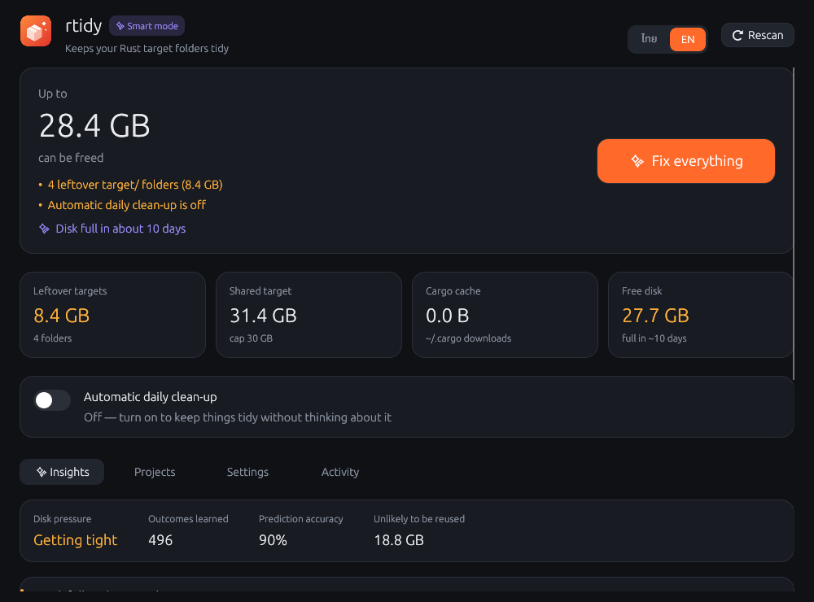
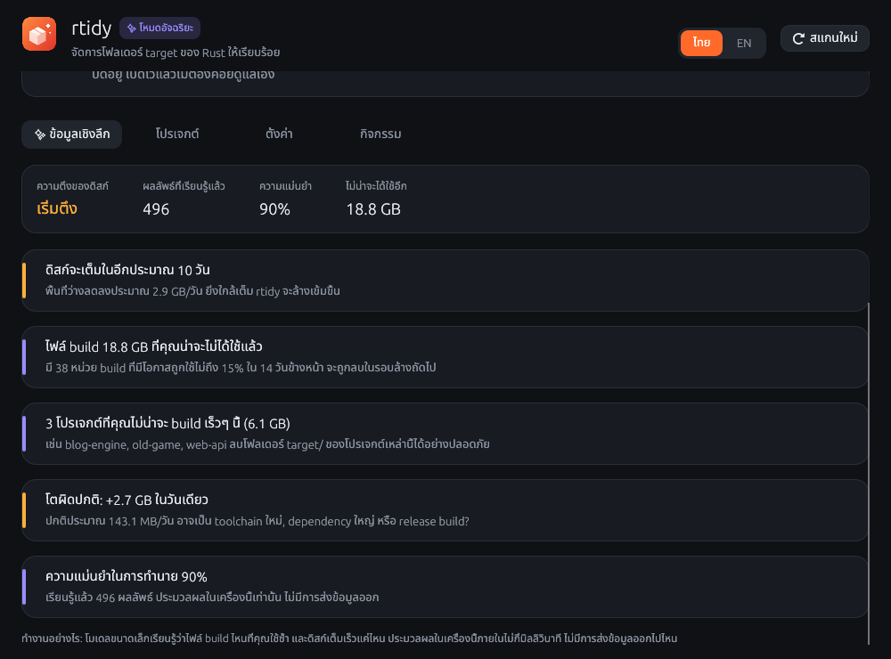

<p align="center"></p>
<h1 align="center">rtidy</h1>
<p align="center">Keeps your Rust <code>target/</code> folders tidy — on Windows, macOS and Linux. English &amp; ไทย.</p>

<p align="center"></p>

<p align="center"></p>

## The problem

Every Rust project grows its own `target/` folder, often several GB each, scattered across your disk.
Shared dependencies get compiled again and again, and nothing ever cleans up.

## What rtidy does (one click)

1. **One shared target folder** — every project builds into the same place (`build.target-dir` in `~/.cargo/config.toml`), so new `target/` folders stop appearing and shared dependencies compile once.
2. **Lean builds** — dependencies skip debug info (often half the size); your own code keeps it.
3. **Removes leftovers** — old per-project `target/` folders (except projects marked *Keep*).
4. **Trims the shared folder** — drops incremental caches, artifacts unused for N days, and keeps it under a size cap.
5. **Trims the cargo download cache** in `~/.cargo`.
6. **Cleans itself every day** — Task Scheduler (Windows), launchd (macOS), systemd timer or cron (Linux). Missed runs catch up when the computer is back on.

## Smart mode (on-device AI)

A tiny machine-learning brain — no LLM, no GPU, no internet. It is a few hundred numbers in a JSON file, and each analysis takes milliseconds.

- **Reuse prediction.** An online logistic-regression model scores every build unit in the shared folder, and every leftover project `target/`, by the chance you'll use it again within 14 days. Inputs are how recently and how often it was used, how long it has existed, its size and recent git activity. Units you won't need go first; anything used in the last day or two is never touched.
- **It learns from outcomes.** Every prediction is checked 14 days later. If rtidy removed something and you rebuilt it, the model learns it was wrong.
- **Disk forecast.** Weighted regression over free-space history gives "disk full in ~N days". The cleaning threshold and the size cap tighten automatically as the disk fills up.
- **Anomaly alerts.** A robust median/MAD test flags unusual growth, for example a new toolchain or a huge dependency.
- **Smart schedule.** rtidy learns the hours you never build and moves the daily clean-up there.

The **Insights** tab explains every decision. Hard limits from Settings still apply, and Smart mode can be switched off.

## Language

English and Thai (ไทย). rtidy picks your system language and you can switch anytime (EN | ไทย in the header or Settings). A Thai font (Noto Sans Thai, OFL) is bundled, so Thai renders on every OS.

## Install

Build from source (see below), or download installers from **Actions → build → Artifacts**:

| OS | File |
|---|---|
| Windows | `rtidy-setup-x64.exe` (installer) or `rtidy-windows-x64-portable.exe` |
| macOS (Intel + Apple Silicon) | `rtidy-macos-universal.dmg` — drag to Applications. First launch: right-click → Open (not notarized) |
| Linux | `rtidy_<ver>_amd64.deb`, `rtidy-x86_64.AppImage`, or `rtidy-linux-x86_64.tar.gz` |

Or from source: `cargo install --git https://github.com/thirawat27/rtidy`

## Use

**Open the app** → the setup wizard walks you through folders and options → **Tidy up now**. Done; it keeps itself tidy from then on.

Prefer the terminal? One command does the same:

```sh
rtidy fix            # uses detected/saved folders
rtidy fix ~/code     # or name them
```

<details>
<summary>All commands</summary>

| Command | What it does |
|---|---|
| `rtidy` | Open the app |
| `rtidy fix [folders]` | Everything in one go (saves settings) |
| `rtidy insights` | AI insights: forecast, what you won't reuse, unusual growth |
| `rtidy doctor [folders]` | Where the space went and how to fix it |
| `rtidy scan [folders]` | List `target/` folders with size and age |
| `rtidy clean [folders] --days 30 [--dry-run]` | Delete `target/` not built for N days |
| `rtidy setup [--lean] [--target-dir P]` | Shared target folder only |
| `rtidy gc [--days 14] [--max-size 30G]` | Trim the shared folder |
| `rtidy cache [--days 30]` | Trim `~/.cargo` downloads |
| `rtidy auto` | What the daily task runs (saved settings) |
| `rtidy schedule [--at 21:00] / --remove` | Daily task on/off |
| `rtidy log` | Results of past daily runs |
| `rtidy uninstall` | Remove the daily task and menu entry |

Put an empty `.rtidy-keep` file next to a project's `Cargo.toml` to never clean it.
</details>

## Good to know

- Two projects building at the same time wait for each other's lock on the shared folder.
- Binaries with the same name from different projects overwrite each other in `<shared>/debug/`; use `cargo run` / `cargo install` rather than copying from there.
- A project with its own `target-dir` setting keeps it (`rtidy doctor` lists these).
- On Windows the app is a GUI program; in a terminal its output appears after the prompt returns.
- To undo the shared folder, delete `target-dir` under `[build]` in `~/.cargo/config.toml` (a backup is saved as `config.toml.bak`).
