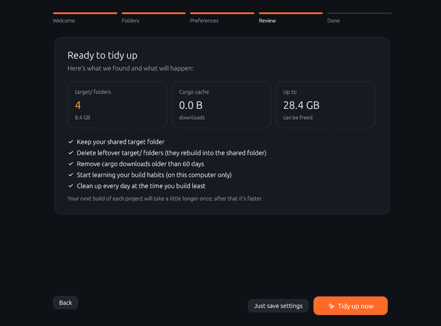
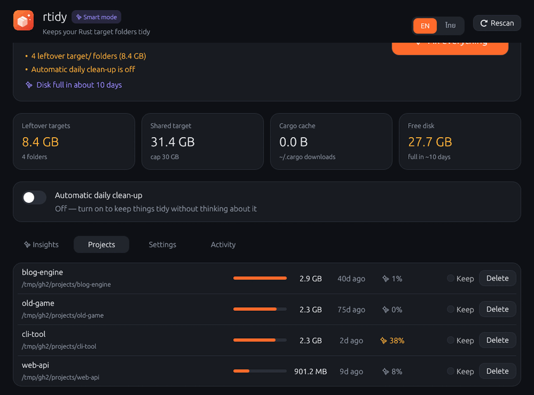

<p align="center"></p>
<h1 align="center">rtidy</h1>
<p align="center">จัดการโฟลเดอร์ <code>target/</code> ของ Rust ให้เรียบร้อย ใช้ได้ทั้ง Windows, macOS และ Linux<br>
<a href="README.md">English</a> · <b>ภาษาไทย</b></p>

<p align="center"></p>

## ปัญหา

ทุกโปรเจกต์ Rust จะสร้างโฟลเดอร์ `target/` ของตัวเอง ซึ่งมักมีขนาดหลาย GB และกระจายอยู่ทั่วดิสก์
dependency ตัวเดียวกันถูก compile ซ้ำในทุกโปรเจกต์ และไม่มีอะไรมาคอยล้างให้

## rtidy ทำอะไรให้ (กดปุ่มเดียว)

1. **โฟลเดอร์ target กลางที่เดียว** ทุกโปรเจกต์ build ลงที่เดียวกัน `target/` ใหม่จึงไม่โผล่ตามโปรเจกต์อีก และ dependency ที่ใช้ร่วมกัน compile แค่ครั้งเดียว
2. **Lean builds** dependency ไม่เก็บ debug info (มักกินพื้นที่ครึ่งหนึ่ง) แต่โค้ดของคุณยังเก็บไว้ครบ
3. **ลบของค้าง** ลบ `target/` เก่าตามโปรเจกต์ ยกเว้นโปรเจกต์ที่ติ๊ก *เก็บไว้*
4. **ลดขนาดโฟลเดอร์กลาง** ลบ incremental cache และไฟล์ที่ไม่น่าจะได้ใช้อีก และคุมขนาดไม่ให้เกินที่ตั้งไว้
5. **ลดแคชดาวน์โหลด** ใน `~/.cargo`
6. **ล้างเองทุกวัน** ผ่าน Task Scheduler (Windows), launchd (macOS) หรือ systemd/cron (Linux) ถ้าเครื่องปิดอยู่ตอนถึงเวลา จะรันชดเชยครั้งเดียวตอนเปิดเครื่องหรือ login ครั้งถัดไป
7. **ดูก่อนลบ และย้อนกลับได้** ทุกรอบจะทำ *แผน* ให้ดูก่อน และโฟลเดอร์ผลลัพธ์ build ที่ถูกลบยังกู้คืนได้อีกหลายวัน

## ดูก่อนลบ และย้อนกลับได้

ทุกการล้างเริ่มจาก **แผน** ไม่ใช่เริ่มจากการลบ แผนคือรายการว่าจะเอาอะไรออก ขนาดเท่าไร อายุกี่วัน
โอกาสที่คุณจะใช้ซ้ำ (เมื่อเปิดโหมดอัจฉริยะ) เวลาที่ต้อง build ใหม่โดยประมาณ และเหตุผลที่มันอยู่ในแผน
ในแอปมีแท็บ **ดูก่อนลบ** และปุ่มบนหน้าแรก เห็นทุกอย่างก่อนของจริงจะหายไป แล้วค่อยกด **จัดการเลย**

แผนไม่ได้เรียงตามขนาดเฉยๆ แต่เรียงตาม *พื้นที่ที่ได้คืนต่อวินาทีที่ต้อง build ใหม่* แล้วลดน้ำหนักด้วย
โอกาสใช้ซ้ำจากโมเดล — คืน 12 GB แลกกับ build ใหม่ 40 วินาทีเป็นดีลที่ดี คืน 80 MB แลกกับเก้านาทีไม่ใช่
ทุกบรรทัดในแท็บโปรเจกต์และในหน้าดูก่อนลบจึงบอกเวลา build ใหม่โดยประมาณไว้ด้วย (เป็นค่าประมาณ ไม่ใช่คำสัญญา)

โฟลเดอร์ผลลัพธ์ build ของโปรเจกต์จะไม่ถูกลบทิ้งทันที แต่ถูก **ย้าย** (rename) ไปที่ `.rtidy-trash`
ที่โคนไดรฟ์เดียวกัน เพราะอยู่ไดรฟ์เดียวกัน การย้ายจึงเสร็จทันทีไม่ว่าโฟลเดอร์ใหญ่แค่ไหน และตำแหน่งเดิม
ถูกบันทึกไว้ในดัชนี กู้คืนด้วย `rtidy undo` หรือปุ่ม **ย้อนการล้างครั้งล่าสุด** ที่หน้าแรกของแอป

ของในถังจะถูกลบจริงเมื่อเกิน `trash_days` (ค่าเริ่มต้น 3 วัน ตั้งได้ 0–30 ในหน้าตั้งค่า, 0 = ลบทันที ไม่มีให้กู้)
และการลบจริงนั้นเกิดตอนเริ่มการล้างรอบถัดไป ซึ่งเป็นตอนที่พื้นที่คืนมาจริง
แคชและ build unit ในโฟลเดอร์กลางไม่เข้าถังขยะ เพราะมันสร้างหรือดาวน์โหลดใหม่ได้เอง การเก็บสำเนาไว้มีแต่จะกินที่เปล่าๆ
และถ้าดิสก์เต็มถึงขั้นวิกฤต รอบอัตโนมัติจะลบทิ้งตรงๆ แล้วบอกไว้ใน log

```sh
rtidy plan [โฟลเดอร์] [--days N] [--json]   # จะเอาอะไรออก โดยไม่เอาอะไรออกเลย
rtidy undo [--all]                          # เอากลับมา: รอบล่าสุด หรือทุกอย่างที่ยังกู้ได้
rtidy trash [--empty]                       # ในถังมีอะไร เหลือเวลาอีกเท่าไร หรือเทเลย
```

## ภาษาอื่น เป็นส่วนเสริมที่ต้องเปิดเอง

rtidy ยังเป็นเครื่องมือสำหรับ Rust: Cargo เปิดอยู่เสมอ และเป็นภาษาเดียวที่มีกลไกป้องกันที่ต้นเหตุ
(target dir ร่วมอันเดียว) ภาษาอื่นคือส่วนเสริม เปิดสวิตช์เดียวในหน้าตั้งค่าแล้วได้อีก 16 ระบบ
ใช้การสแกน, หน้าดูก่อนลบ, การย้อนกลับ และงานรายวันชุดเดียวกัน:

| ระบบ | โฟลเดอร์ผลลัพธ์ที่ดู |
|---|---|
| Node (npm, pnpm, yarn) | `node_modules`, `.next`, `.nuxt`, `.turbo`, `.svelte-kit`, `.parcel-cache` |
| Python | `__pycache__`, `.venv`, `venv`, `.pytest_cache`, `.mypy_cache`, `.ruff_cache`, `.tox`, `dist`, `build` |
| .NET | `bin`, `obj` |
| Gradle (Java, Kotlin, Android) | `build`, `.gradle`, `.kotlin` |
| Maven | `target` |
| Go | ไม่มีของต่อโปรเจกต์ที่ควรลบ — แคชอยู่ที่สโตร์ต่อผู้ใช้ทั้งหมด |
| CMake (C, C++) | `build`, `cmake-build-debug`, `cmake-build-release`, `out` |
| Unity | `Library`, `Temp`, `Obj`, `Logs`, `Build`, `Builds` |
| Unreal Engine | `Binaries`, `Intermediate`, `DerivedDataCache`, `Saved` |
| Godot | `.godot`, `.import` |
| Zig | `zig-cache`, `.zig-cache`, `zig-out` |
| Elixir (Mix) | `_build`, `deps` |
| Swift (SwiftPM) | `.build`, `.swiftpm` |
| Haskell (Stack, Cabal) | `.stack-work`, `dist-newstyle` |
| Dart, Flutter | `.dart_tool`, `build` |
| PHP (Composer) | `vendor` |

แต่ละอันตัดสินจากไฟล์ manifest ที่วางอยู่ข้างๆ โฟลเดอร์ผลลัพธ์ ฉะนั้น `target/` ที่อยู่ข้าง `Cargo.toml` คือ Rust,
ที่อยู่ข้าง `pom.xml` คือ Maven และโฟลเดอร์ชื่อ `build` ที่ไม่มี manifest อยู่ข้างๆ จะไม่ถูกแตะเลย
ปิดหรือเปิดเป็นรายภาษาได้ในหน้าตั้งค่า หรือจาก terminal:

```sh
rtidy langs                    # มีอะไรให้เปิดบ้าง และตอนนี้เปิดอะไรอยู่
rtidy langs --on node --on gradle
rtidy langs --off python
rtidy langs --rust-only        # ปิดภาษาอื่นทั้งหมด กลับไปเป็น Rust เท่านั้น
```

## Showcase

<table>
<tr>
<td width="50%"><br><b>1. ยินดีต้อนรับ</b> เปิดครั้งแรกจะมีตัวช่วยตั้งค่า เลือกภาษาได้ (EN | ไทย)</td>
<td width="50%"><br><b>2. โฟลเดอร์</b> ตรวจหาโฟลเดอร์โค้ดให้อัตโนมัติ จะเพิ่มหรือพิมพ์ path เองก็ได้</td>
</tr>
<tr>
<td><br><b>3. ตั้งค่า</b> โหมดอัจฉริยะ, lean builds และการล้างรายวัน ค่าเริ่มต้นใช้ได้เลย</td>
<td><br><b>4. ตรวจสอบ</b> ดูว่าเจออะไรบ้าง และจะทำอะไรต่อ แล้วกด <i>จัดการเลย</i></td>
</tr>
<tr>
<td><br><b>แดชบอร์ด</b> พื้นที่ที่คืนได้, พยากรณ์ดิสก์ และปุ่ม <i>จัดการทั้งหมด</i></td>
<td><br><b>ข้อมูลเชิงลึก</b> พยากรณ์ดิสก์, ไฟล์ที่ไม่น่าจะได้ใช้, การโตผิดปกติ และความแม่นยำของโมเดล</td>
</tr>
<tr>
<td><br><b>โปรเจกต์</b> target/ ที่ค้างอยู่ พร้อมขนาด, อายุ และโอกาสที่คุณจะ build อีก (ทำนายโดย AI)</td>
<td><br><b>ตั้งค่า</b> ภาษา, โหมดอัจฉริยะ, โฟลเดอร์ และขีดจำกัดที่ใช้เสมอ</td>
</tr>
</table>

<sub>ภาพหน้าจอใช้ข้อมูลตัวอย่าง ตัวเลขของคุณจะแตกต่างออกไป</sub>

## Use cases

| สถานการณ์ | rtidy ช่วยอะไร |
|---|---|
| **โน้ตบุ๊ก SSD เล็ก** (256–512 GB) ที่เต็มอยู่เรื่อยๆ | พยากรณ์ว่า *"ดิสก์จะเต็มในอีก ~N วัน"* ยิ่งใกล้เต็มยิ่งล้างเข้มขึ้น และคุมขนาดโฟลเดอร์กลางไม่ให้เกินที่ตั้งไว้ |
| **มีโปรเจกต์เล็กๆ เยอะ** เช่น ตามบทเรียน, Advent of Code, ลองของ, clone ตัวอย่างมา | ไม่สร้าง `target/` ใหม่ในทุกโปรเจกต์อีก crate ที่ใช้บ่อยอย่าง `serde`, `tokio`, `syn` compile แค่ครั้งเดียวแล้วใช้ร่วมกัน |
| **สาย open source** ที่สลับทำหลาย repo หลาย branch | โปรเจกต์ที่เลิกทำแล้วจะถูกล้างก่อน (โมเดลเรียนรู้ว่าคุณกลับไปทำโปรเจกต์ไหนบ้าง) และติ๊ก *เก็บไว้* เพื่อกันโปรเจกต์ที่ยังทำอยู่ได้ |
| **ทำเกม/กราฟิก** (Bevy, wgpu, egui) ที่ debug build ใหญ่หลาย GB | Lean builds ตัด debug info ของ dependency และเตือนเมื่อขนาดโตพรวด เช่น มี release build หรือ toolchain ใหม่ |
| **เครื่องที่ห้ามช้าตอนกำลัง build** | ตารางเวลาอัจฉริยะเรียนรู้ช่วงที่คุณไม่ build แล้วล้างตอนนั้น ส่วนไฟล์ที่ใช้ภายใน 1–2 วันล่าสุดจะไม่ถูกแตะ |
| **ห้องเรียน, bootcamp หรือเครื่องในทีม** | มีตัวติดตั้งและตัวช่วยตั้งค่า 4 ขั้นตอน ใครก็ตั้งได้ในนาทีเดียว เลือกได้ทั้งไทยและอังกฤษ ไม่ต้องใช้ terminal |
| **ใช้แต่ terminal / server / CI runner** | `rtidy fix` ตั้งทุกอย่างในคำสั่งเดียว, `rtidy auto` รันตามเวลา และ `rtidy insights` แสดงผลวิเคราะห์ |

## โหมดอัจฉริยะ (AI ในเครื่อง)

ML ขนาดเล็ก ไม่ใช่ LLM ไม่ต้องใช้ GPU หรืออินเทอร์เน็ต ทั้งโมเดลเป็นตัวเลขไม่กี่ร้อยตัวในไฟล์ JSON และวิเคราะห์เสร็จภายในไม่กี่มิลลิวินาที

- **ทำนายว่าจะได้ใช้อีกไหม** ใช้ online logistic regression ให้คะแนนไฟล์ build แต่ละชิ้น และ `target/` ที่ค้างอยู่แต่ละโปรเจกต์ ว่ามีโอกาสถูกใช้อีกภายใน 14 วันแค่ไหน โดยดูจากการใช้ล่าสุด, ความถี่, อายุ, ขนาด และกิจกรรมใน git
- **เรียนรู้จากผลจริง** ทุกการทำนายจะถูกตรวจผลหลัง 14 วัน ถ้าลบไปแล้วคุณ build กลับมา โมเดลจะเรียนรู้ว่าทายผิด
- **พยากรณ์ดิสก์** ใช้ weighted regression ดูแนวโน้มพื้นที่ว่าง แล้วปรับเกณฑ์การล้างและขนาดสูงสุดให้เข้มขึ้นเองเมื่อดิสก์ใกล้เต็ม
- **เตือนเมื่อผิดปกติ** ใช้วิธี median/MAD ตรวจจับการโตผิดปกติ
- **ตารางเวลาอัจฉริยะ** ย้ายเวลาล้างไปช่วงที่คุณไม่ build

แท็บ **ข้อมูลเชิงลึก** อธิบายทุกการตัดสินใจ ขีดจำกัดในหน้าตั้งค่ายังใช้เสมอ และปิดโหมดอัจฉริยะได้ทุกเมื่อ
การจัดอันดับในแผนและ `rtidy gc` ก็ใช้โมเดลช่วยตัดสินเมื่อเปิดโหมดอัจฉริยะไว้

## ชุดตั้งค่าสำเร็จรูป

ในหน้าตั้งค่ามีตัวเลขให้ตัดสินใจแปดค่า และทุกค่าคือการแลกได้แลกเสียจริงๆ ชุดสำเร็จรูปคือการตอบ
ทั้งแปดข้อในครั้งเดียว — เลือกหนึ่งอันใน **หน้าตั้งค่า** (หรือตอนตั้งค่าครั้งแรก) แล้วตัวเลขจะขยับไปพร้อมกัน
ปรับเองทีหลังได้ตามใจ ถ้าปรับแล้วมันก็แค่ไม่ถูกนับว่าเป็นชุดนั้นอีกต่อไป

| ชุด | เหมาะกับ |
|---|---|
| **ระวังไว้ก่อน** | ลบเฉพาะที่ตายสนิท: ของค้าง 90 วัน ไม่มีเพดานขนาด ไม่แตะแคชดาวน์โหลด กู้คืนได้สองสัปดาห์ |
| **สมดุล** | ค่าเริ่มต้น — ของค้าง 30 วัน เพดาน 30 GB กู้คืนได้ 3 วัน เฉพาะ Rust |
| **ดิสก์เล็ก** | โน้ตบุ๊ก 256 GB ที่เต็มตลอด: ของค้าง 7 วัน เพดาน 15 GB กู้คืนได้ 1 วัน |
| **เครื่องทำงานหลัก** | build ต้องไม่สะดุด: เกณฑ์ใจเย็น เพดาน 60 GB กู้คืนได้หนึ่งสัปดาห์ เฉพาะ Rust |
| **เครื่อง CI** | ไม่มีคนนั่ง: ไม่พักของไว้กู้ ไม่มีงานรายวัน ปิดโหมดอัจฉริยะเพื่อให้ทุกรอบเหมือนกัน |

```sh
rtidy preset                      # ดูรายการ และตอนนี้ใช้ชุดไหนอยู่
rtidy preset small-disk           # ใช้ชุดนั้น
rtidy preset ci --dry-run         # ดูว่าจะเปลี่ยนอะไรบ้าง ทีละบรรทัด
```

ชุดสำเร็จรูปไม่แตะโฟลเดอร์โปรเจกต์ ภาษาของแอป เวลาล้างรายวัน และสวิตช์ **ภาษาอื่น** กับรายการภาษาใต้มัน
สวิตช์นั้นเปลี่ยน *ขอบเขตว่า rtidy ลบอะไรได้บ้าง* ไม่ใช่แค่ความหนักในการล้าง มันจึงปิดไว้จนกว่าคุณจะเปิดเอง
ไม่มีชุดสำเร็จรูป การอัปเดต หรือดิสก์ที่ใกล้เต็ม ไปเปิดมันให้

## สโตร์แพ็กเกจของแต่ละภาษา

npm, pnpm, yarn, pip, uv, Gradle, Maven, NuGet, Go, Hex, pub, Composer และ Zig
ดาวน์โหลดลงที่เดียวต่อผู้ใช้อยู่แล้ว จึงไม่มีอะไรต้องป้องกันที่ต้นเหตุ ปัญหาของมันคือโตไปเรื่อยๆ
เพราะไม่มีอะไรหมดอายุและไม่มีใครล้าง rtidy หาให้ วัดขนาดให้ และตัดรายการที่ไม่ถูกแตะเกิน
`store_days` (ค่าเริ่มต้น 120 วัน) ออกจากแผนเดียวกับของอื่น

และตั้งใจไม่ย้ายที่ให้ เพราะตำแหน่งของสโตร์พวกนี้คือ environment variable
(`GOCACHE`, `GRADLE_USER_HOME`, `NUGET_PACKAGES` และอื่นๆ) ที่ shell, สคริปต์ CI และ IDE อ่านอยู่
การไปตั้งให้ลับหลังคือวิธีทำให้ toolchain หาแพ็กเกจของตัวเองไม่เจอ — `rtidy doctor` บอกชื่อตัวแปรให้
แล้วปล่อยให้คุณตัดสินใจเอง

```sh
rtidy stores [--days N] [--dry-run]   # อยู่ไหน ใหญ่แค่ไหน อะไรค้างนาน
```

## โหมดเฝ้าดู

งานรายวันเป็นค่าเริ่มต้นที่ถูกต้องแล้ว แต่แคช incremental ของงานที่ทำเสร็จตอนสิบโมงจะนอนรออยู่ถึงกลางคืน
`rtidy watch` ปิดช่องว่างนั้น: เฝ้า target dir ร่วม แล้วตัดแคช incremental (และบังคับเพดานขนาด)
หลังการ build หยุดไปสองสามนาที ช่วงเงียบตั้งที่ `watch_idle_mins` ค่าเริ่มต้น 10 นาที
และโหมดนี้ **ไม่ลบโฟลเดอร์ผลลัพธ์ build ของโปรเจกต์เลย** เพราะกำลังมีคนทำงานอยู่ ของพวกนั้นปล่อยให้เป็นหน้าที่
ของงานรายวัน หน้าดูก่อนลบ และแอป

```sh
rtidy watch           # ค้างไว้ ctrl-c เพื่อหยุด
rtidy watch --once    # เช็กรอบเดียวแล้วออก เหมาะกับ cron
```

## กฎต่อ repository

วางไฟล์ `.rtidy.toml` ไว้ข้าง manifest ของโปรเจกต์ แล้ว commit ไปกับ repo ได้เลย กฎจึงติดไปกับโค้ดทั้งทีม
ไม่ใช่อยู่แค่เครื่องใครเครื่องมัน:

```toml
keep = true            # ห้ามล้างโปรเจกต์นี้
days = 90              # ต้องเก่ากว่านี้ก่อนจึงล้างได้
trash_days = 7         # กู้คืนได้นานกว่าปกติ
all_langs = true       # ล้างภาษาอื่นในโปรเจกต์นี้ด้วย
except = [".venv"]     # เว้นโฟลเดอร์ผลลัพธ์ชื่อนี้ไว้
```

ช่อง **เก็บไว้** ในแอปเขียนไฟล์นี้ให้ ไฟล์ `.rtidy-keep` แบบเดิมยังใช้ได้และยังหมายถึง `keep = true`
ส่วนค่าที่เป็นของทั้งเครื่อง (จะเปิดภาษาไหน, ตารางเวลา, โฟลเดอร์กลาง) ยังอยู่ในหน้าตั้งค่า
หน้าดูก่อนลบจะบอกด้วยว่าโปรเจกต์ไหนถูกเว้นไว้ และเพราะกฎข้อไหน

## CI และทีม

`rtidy plan --json` พิมพ์แผนทั้งหมดเป็น JSON (ยอดที่จะคืน, เวลา build ใหม่, ทุกรายการ, แยกตามภาษา)
ให้ job เอาไปอ่านหรือเก็บเป็น artifact ได้

`rtidy budget 50G [โฟลเดอร์]` ล้างเท่าที่จำเป็นให้มีพื้นที่ว่างถึงที่ขอ โดยหยิบของที่คุ้มที่สุดก่อนแล้วหยุด
ทันทีที่ถึงเป้า ถ้าทำไม่ถึงจะออกด้วย exit code 3 — เขียนเป็น step หนึ่งก่อน build ได้ตรงๆ

## ประวัติที่ประหยัดได้

ทุกรอบจะบันทึกว่าคืนพื้นที่ไปเท่าไร แยกตามภาษา แท็บ **กิจกรรม** ในแอปแสดงยอดรวมตั้งแต่ติดตั้ง
จำนวนวัน เฉลี่ยต่อวัน จำนวนรอบที่รันไป และสัดส่วนรายภาษา ของที่กู้คืนกลับไปแล้วถูกหักออกจากยอด
ตัวเลขจึงเป็นของจริง ไม่ใช่ยอดที่พูดให้ดูดี (`rtidy log` ก็อ่านตัวเลขชุดเดียวกัน)

## ติดตั้ง

build จาก source (ดูด้านล่าง) หรือดาวน์โหลดตัวติดตั้งจาก **Actions → build → Artifacts**:

| OS | ไฟล์ |
|---|---|
| Windows | `rtidy-setup-x64.exe` (ตัวติดตั้ง) หรือ `rtidy-windows-x64-portable.exe` |
| macOS (Intel + Apple Silicon) | `rtidy-macos-universal.dmg` ลากไปใส่ Applications เปิดครั้งแรก: คลิกขวา → Open |
| Linux | `rtidy_<ver>_amd64.deb`, `rtidy-x86_64.AppImage` หรือ `rtidy-linux-x86_64.tar.gz` |

### ติดตั้งด้วย cargo

```sh
cargo install rtidy                           # แอป + CLI
cargo install rtidy --no-default-features     # เฉพาะ CLI ไม่มีแอปเดสก์ท็อป
```

แอปเดสก์ท็อปคือ feature ชื่อ `gui` ซึ่งเปิดไว้เป็นค่าเริ่มต้น มันดึง `eframe` เข้ามา
ซึ่งเป็น dependency ส่วนใหญ่ของ rtidy (135 crates เทียบกับ 55) และบน Linux ต้องมี
dev headers ของ X11/Wayland ด้วย ถ้าใช้ `--no-default-features` จะได้เฉพาะเครื่องมือ
บรรทัดคำสั่ง ไฟล์ 2 MB build ได้ทุกที่โดยไม่ต้องมี system library อะไรเลย
ความสามารถอื่นๆ เหมือนเดิมทุกอย่าง ต่างแค่ไม่มีหน้าต่าง

ติดตั้งจาก repository ตรงๆ โดยไม่ผ่าน crates.io:

```sh
cargo install --git https://github.com/thirawat27/Rtidy
```

## วิธีใช้

**เปิดแอป** แล้วตัวช่วยตั้งค่าจะพาเลือกโฟลเดอร์และตัวเลือก จากนั้นกด **จัดการเลย** ก็เสร็จ หลังจากนั้นแอปจะดูแลตัวเองทุกวัน

ถ้าชอบใช้ terminal พิมพ์คำสั่งเดียวก็ได้ผลเหมือนกัน:

```sh
rtidy fix            # ใช้โฟลเดอร์ที่ตรวจพบหรือที่บันทึกไว้
rtidy fix ~/code     # หรือระบุโฟลเดอร์เอง
```

| คำสั่ง | ทำอะไร |
|---|---|
| `rtidy` | เปิดแอป |
| `rtidy fix [โฟลเดอร์]` | ทำทุกอย่างในคำสั่งเดียว (บันทึกค่าไว้ใช้ครั้งต่อไป) |
| `rtidy plan [โฟลเดอร์] [--days N] [--json]` | จะเอาอะไรออก โดยไม่เอาอะไรออกจริง |
| `rtidy undo [--all]` | เอาของจากรอบล่าสุด (หรือทุกอย่างที่ยังกู้ได้) กลับมา |
| `rtidy trash [--empty]` | ในถังมีอะไร เหลือเวลาเท่าไร หรือเทเลย |
| `rtidy watch [--once]` | ตัดแคช incremental หลัง build หยุด แทนการรอรอบรายวัน |
| `rtidy stores [--days N] [--dry-run]` | สโตร์แพ็กเกจของแต่ละภาษา: อยู่ไหน ใหญ่แค่ไหน อะไรค้างนาน |
| `rtidy langs [--on ID] [--off ID] [--rust-only]` | เลือกว่าจะล้างภาษาไหน (Rust เปิดอยู่เสมอ) |
| `rtidy budget 50G [โฟลเดอร์]` | ล้างจนมีที่ว่างถึงที่ขอ ออกด้วย exit code 3 ถ้าไม่ถึง |
| `rtidy insights` | ผลวิเคราะห์จาก AI: พยากรณ์ดิสก์, ของที่ไม่น่าได้ใช้, การโตผิดปกติ |
| `rtidy doctor [โฟลเดอร์]` | พื้นที่หายไปไหน และควรทำอะไรต่อ |
| `rtidy scan [โฟลเดอร์]` | ลิสต์ `target/` พร้อมขนาดและอายุ |
| `rtidy clean [โฟลเดอร์] --days 30 [--dry-run]` | ลบ `target/` ที่ไม่ได้ build มา N วัน |
| `rtidy setup [--lean] [--target-dir P]` | ตั้งโฟลเดอร์ target กลางเท่านั้น |
| `rtidy gc [--days 14] [--max-size 30G]` | ลดขนาดโฟลเดอร์กลาง |
| `rtidy cache [--days 30]` | ลดแคชดาวน์โหลดใน `~/.cargo` |
| `rtidy auto` | สิ่งที่งานรายวันรัน (ใช้ค่าที่บันทึกไว้) |
| `rtidy schedule [--at 21:00] / --remove` | เปิด/ปิดงานรายวัน |
| `rtidy log` | ผลของรอบรายวันที่ผ่านมา |
| `rtidy uninstall` | ลบงานรายวันและเมนูในเครื่อง |

ข้อควรรู้เพิ่มเติมดูได้ใน [README ภาษาอังกฤษ](README.md#use)

## เก็บสถานะไว้ที่อื่น

ตั้ง `RTIDY_HOME` แล้วทุกอย่างที่ rtidy จำไว้ — การตั้งค่า, โมเดล, ดัชนีถังขยะ, ประวัติที่ประหยัดได้
และ log ของการรัน — จะไปอยู่ในโฟลเดอร์ที่คุณกำหนดแทน มีประโยชน์บน CI runner, เครื่องที่ใช้ร่วมกัน
หรือตอนอยากลองเล่นโดยไม่ทับการตั้งค่าเดิมที่มีอยู่

## ผู้พัฒนา

**Thirawat Sinlapasomsak** — [github.com/thirawat27](https://github.com/thirawat27)

## ใบอนุญาต

สงวนลิขสิทธิ์ © 2026 Thirawat Sinlapasomsak

rtidy เป็นซอฟต์แวร์เสรีภายใต้ [GNU General Public License v3.0](LICENSE)
คุณใช้ ศึกษา แจกจ่าย และแก้ไขได้ แต่ถ้าแจกจ่ายรุ่นที่แก้ไขแล้ว
ต้องใช้ใบอนุญาตเดียวกันและแนบ source ไปด้วย ซอฟต์แวร์นี้ไม่มีการรับประกันใดๆ
