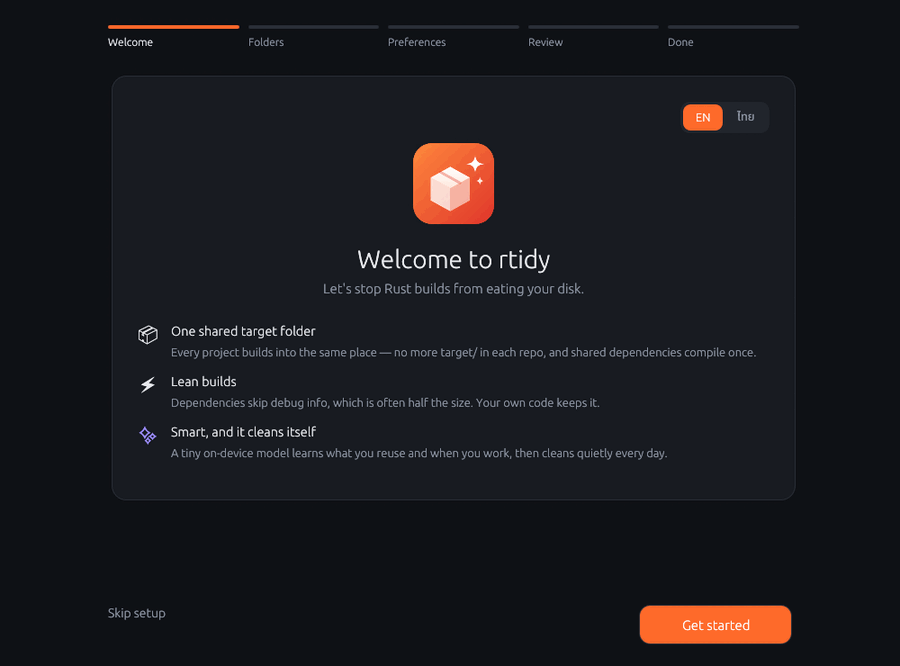
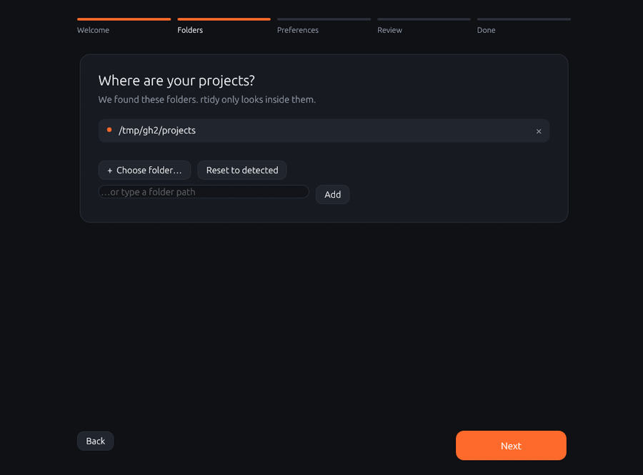
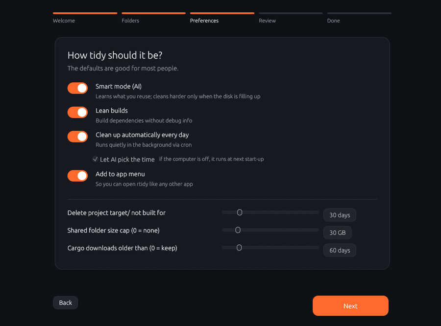
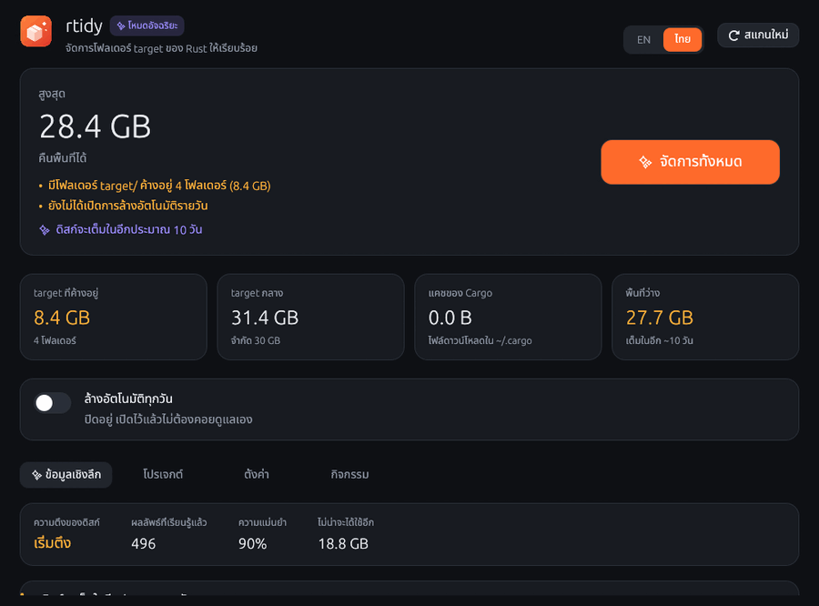
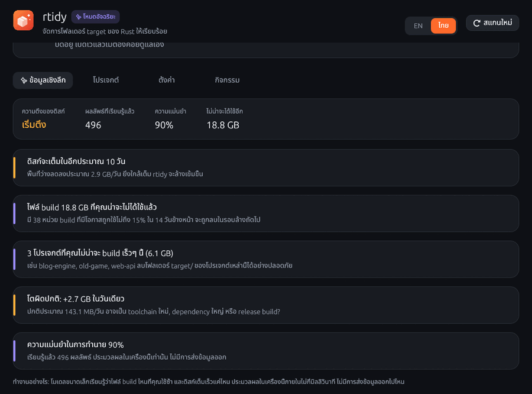
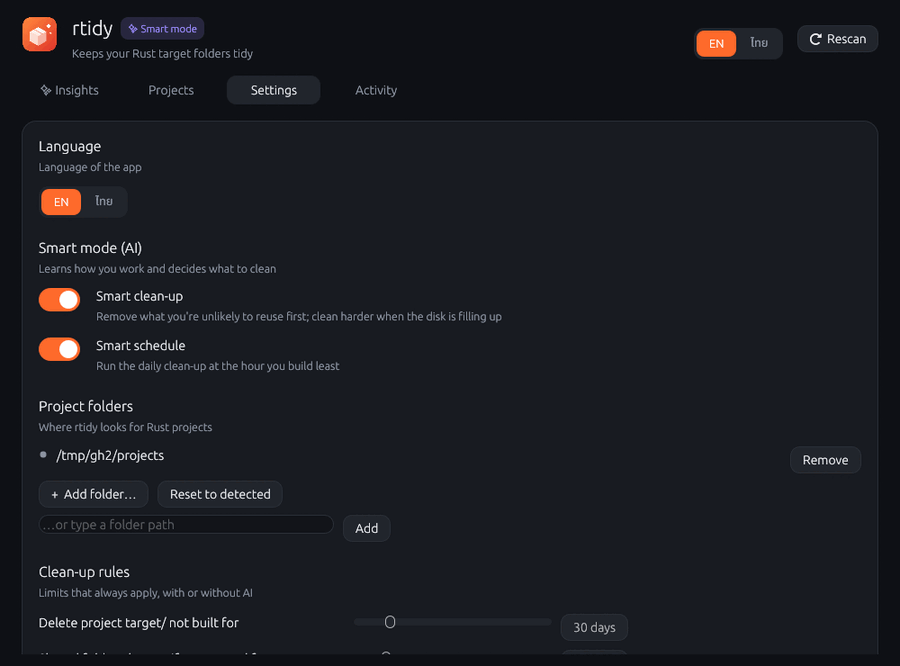

<p align="center"></p>
<h1 align="center">rtidy</h1>
<p align="center">จัดการโฟลเดอร์ <code>target/</code> ของ Rust ให้เรียบร้อย ใช้ได้ทั้ง Windows, macOS และ Linux<br>
<a href="README.md">English</a> · <b>ภาษาไทย</b></p>

<p align="center"></p>

## ปัญหา

ทุกโปรเจกต์ Rust จะสร้างโฟลเดอร์ `target/` ของตัวเอง ซึ่งมักมีขนาดหลาย GB และกระจายอยู่ทั่วดิสก์
dependency ตัวเดียวกันถูก compile ซ้ำในทุกโปรเจกต์ และไม่มีอะไรมาคอยล้างให้

## rtidy ทำอะไรให้ (กดปุ่มเดียว)

1. **โฟลเดอร์ target กลางที่เดียว** ทุกโปรเจกต์ build ลงที่เดียวกัน `target/` ใหม่จึงไม่โผล่ตามโปรเจกต์อีก และ dependency ที่ใช้ร่วมกัน compile แค่ครั้งเดียว
2. **Lean builds** dependency ไม่เก็บ debug info (มักกินพื้นที่ครึ่งหนึ่ง) แต่โค้ดของคุณยังเก็บไว้ครบ
3. **ลบของค้าง** ลบ `target/` เก่าตามโปรเจกต์ ยกเว้นโปรเจกต์ที่ติ๊ก *เก็บไว้*
4. **ลดขนาดโฟลเดอร์กลาง** ลบ incremental cache และไฟล์ที่ไม่น่าจะได้ใช้อีก และคุมขนาดไม่ให้เกินที่ตั้งไว้
5. **ลดแคชดาวน์โหลด** ใน `~/.cargo`
6. **ล้างเองทุกวัน** ผ่าน Task Scheduler (Windows), launchd (macOS) หรือ systemd/cron (Linux) ถ้าเครื่องปิดอยู่ตอนถึงเวลา จะรันชดเชยครั้งเดียวตอนเปิดเครื่องหรือ login ครั้งถัดไป

## Showcase

<table>
<tr>
<td width="50%"><br><b>1. ยินดีต้อนรับ</b> เปิดครั้งแรกจะมีตัวช่วยตั้งค่า เลือกภาษาได้ (EN | ไทย)</td>
<td width="50%"><br><b>2. โฟลเดอร์</b> ตรวจหาโฟลเดอร์โค้ดให้อัตโนมัติ จะเพิ่มหรือพิมพ์ path เองก็ได้</td>
</tr>
<tr>
<td><br><b>3. ตั้งค่า</b> โหมดอัจฉริยะ, lean builds และการล้างรายวัน ค่าเริ่มต้นใช้ได้เลย</td>
<td><br><b>4. ตรวจสอบ</b> ดูว่าเจออะไรบ้าง และจะทำอะไรต่อ แล้วกด <i>จัดการเลย</i></td>
</tr>
<tr>
<td><br><b>แดชบอร์ด</b> พื้นที่ที่คืนได้, พยากรณ์ดิสก์ และปุ่ม <i>จัดการทั้งหมด</i></td>
<td><br><b>ข้อมูลเชิงลึก</b> พยากรณ์ดิสก์, ไฟล์ที่ไม่น่าจะได้ใช้, การโตผิดปกติ และความแม่นยำของโมเดล</td>
</tr>
<tr>
<td><br><b>โปรเจกต์</b> target/ ที่ค้างอยู่ พร้อมขนาด, อายุ และโอกาสที่คุณจะ build อีก (ทำนายโดย AI)</td>
<td><br><b>ตั้งค่า</b> ภาษา, โหมดอัจฉริยะ, โฟลเดอร์ และขีดจำกัดที่ใช้เสมอ</td>
</tr>
</table>

<sub>ภาพหน้าจอใช้ข้อมูลตัวอย่าง ตัวเลขของคุณจะแตกต่างออกไป</sub>

## Use cases

| สถานการณ์ | rtidy ช่วยอะไร |
|---|---|
| **โน้ตบุ๊ก SSD เล็ก** (256–512 GB) ที่เต็มอยู่เรื่อยๆ | พยากรณ์ว่า *"ดิสก์จะเต็มในอีก ~N วัน"* ยิ่งใกล้เต็มยิ่งล้างเข้มขึ้น และคุมขนาดโฟลเดอร์กลางไม่ให้เกินที่ตั้งไว้ |
| **มีโปรเจกต์เล็กๆ เยอะ** เช่น ตามบทเรียน, Advent of Code, ลองของ, clone ตัวอย่างมา | ไม่สร้าง `target/` ใหม่ในทุกโปรเจกต์อีก crate ที่ใช้บ่อยอย่าง `serde`, `tokio`, `syn` compile แค่ครั้งเดียวแล้วใช้ร่วมกัน |
| **สาย open source** ที่สลับทำหลาย repo หลาย branch | โปรเจกต์ที่เลิกทำแล้วจะถูกล้างก่อน (โมเดลเรียนรู้ว่าคุณกลับไปทำโปรเจกต์ไหนบ้าง) และติ๊ก *เก็บไว้* เพื่อกันโปรเจกต์ที่ยังทำอยู่ได้ |
| **ทำเกม/กราฟิก** (Bevy, wgpu, egui) ที่ debug build ใหญ่หลาย GB | Lean builds ตัด debug info ของ dependency และเตือนเมื่อขนาดโตพรวด เช่น มี release build หรือ toolchain ใหม่ |
| **เครื่องที่ห้ามช้าตอนกำลัง build** | ตารางเวลาอัจฉริยะเรียนรู้ช่วงที่คุณไม่ build แล้วล้างตอนนั้น ส่วนไฟล์ที่ใช้ภายใน 1–2 วันล่าสุดจะไม่ถูกแตะ |
| **ห้องเรียน, bootcamp หรือเครื่องในทีม** | มีตัวติดตั้งและตัวช่วยตั้งค่า 4 ขั้นตอน ใครก็ตั้งได้ในนาทีเดียว เลือกได้ทั้งไทยและอังกฤษ ไม่ต้องใช้ terminal |
| **ใช้แต่ terminal / server / CI runner** | `rtidy fix` ตั้งทุกอย่างในคำสั่งเดียว, `rtidy auto` รันตามเวลา และ `rtidy insights` แสดงผลวิเคราะห์ |

## โหมดอัจฉริยะ (AI ในเครื่อง)

ML ขนาดเล็ก ไม่ใช่ LLM ไม่ต้องใช้ GPU หรืออินเทอร์เน็ต ทั้งโมเดลเป็นตัวเลขไม่กี่ร้อยตัวในไฟล์ JSON และวิเคราะห์เสร็จภายในไม่กี่มิลลิวินาที

- **ทำนายว่าจะได้ใช้อีกไหม** ใช้ online logistic regression ให้คะแนนไฟล์ build แต่ละชิ้น และ `target/` ที่ค้างอยู่แต่ละโปรเจกต์ ว่ามีโอกาสถูกใช้อีกภายใน 14 วันแค่ไหน โดยดูจากการใช้ล่าสุด, ความถี่, อายุ, ขนาด และกิจกรรมใน git
- **เรียนรู้จากผลจริง** ทุกการทำนายจะถูกตรวจผลหลัง 14 วัน ถ้าลบไปแล้วคุณ build กลับมา โมเดลจะเรียนรู้ว่าทายผิด
- **พยากรณ์ดิสก์** ใช้ weighted regression ดูแนวโน้มพื้นที่ว่าง แล้วปรับเกณฑ์การล้างและขนาดสูงสุดให้เข้มขึ้นเองเมื่อดิสก์ใกล้เต็ม
- **เตือนเมื่อผิดปกติ** ใช้วิธี median/MAD ตรวจจับการโตผิดปกติ
- **ตารางเวลาอัจฉริยะ** ย้ายเวลาล้างไปช่วงที่คุณไม่ build

แท็บ **ข้อมูลเชิงลึก** อธิบายทุกการตัดสินใจ ขีดจำกัดในหน้าตั้งค่ายังใช้เสมอ และปิดโหมดอัจฉริยะได้ทุกเมื่อ

## ติดตั้ง

build จาก source (ดูด้านล่าง) หรือดาวน์โหลดตัวติดตั้งจาก **Actions → build → Artifacts**:

| OS | ไฟล์ |
|---|---|
| Windows | `rtidy-setup-x64.exe` (ตัวติดตั้ง) หรือ `rtidy-windows-x64-portable.exe` |
| macOS (Intel + Apple Silicon) | `rtidy-macos-universal.dmg` ลากไปใส่ Applications เปิดครั้งแรก: คลิกขวา → Open |
| Linux | `rtidy_<ver>_amd64.deb`, `rtidy-x86_64.AppImage` หรือ `rtidy-linux-x86_64.tar.gz` |

### ติดตั้งด้วย cargo

```sh
cargo install rtidy                           # แอป + CLI
cargo install rtidy --no-default-features     # เฉพาะ CLI ไม่มีแอปเดสก์ท็อป
```

แอปเดสก์ท็อปคือ feature ชื่อ `gui` ซึ่งเปิดไว้เป็นค่าเริ่มต้น มันดึง `eframe` เข้ามา
ซึ่งเป็น dependency ส่วนใหญ่ของ rtidy (135 crates เทียบกับ 55) และบน Linux ต้องมี
dev headers ของ X11/Wayland ด้วย ถ้าใช้ `--no-default-features` จะได้เฉพาะเครื่องมือ
บรรทัดคำสั่ง ไฟล์ 2 MB build ได้ทุกที่โดยไม่ต้องมี system library อะไรเลย
ความสามารถอื่นๆ เหมือนเดิมทุกอย่าง ต่างแค่ไม่มีหน้าต่าง

ติดตั้งจาก repository ตรงๆ โดยไม่ผ่าน crates.io:

```sh
cargo install --git https://github.com/thirawat27/Rtidy
```

## วิธีใช้

**เปิดแอป** แล้วตัวช่วยตั้งค่าจะพาเลือกโฟลเดอร์และตัวเลือก จากนั้นกด **จัดการเลย** ก็เสร็จ หลังจากนั้นแอปจะดูแลตัวเองทุกวัน

ถ้าชอบใช้ terminal พิมพ์คำสั่งเดียวก็ได้ผลเหมือนกัน:

```sh
rtidy fix            # ใช้โฟลเดอร์ที่ตรวจพบหรือที่บันทึกไว้
rtidy fix ~/code     # หรือระบุโฟลเดอร์เอง
```

ดูคำสั่งทั้งหมดและข้อควรรู้เพิ่มเติมได้ใน [README ภาษาอังกฤษ](README.md#use)

## ผู้พัฒนา

**Thirawat Sinlapasomsak** — [github.com/thirawat27](https://github.com/thirawat27)

## ใบอนุญาต

สงวนลิขสิทธิ์ © 2026 Thirawat Sinlapasomsak

rtidy เป็นซอฟต์แวร์เสรีภายใต้ [GNU General Public License v3.0](LICENSE)
คุณใช้ ศึกษา แจกจ่าย และแก้ไขได้ แต่ถ้าแจกจ่ายรุ่นที่แก้ไขแล้ว
ต้องใช้ใบอนุญาตเดียวกันและแนบ source ไปด้วย ซอฟต์แวร์นี้ไม่มีการรับประกันใดๆ
